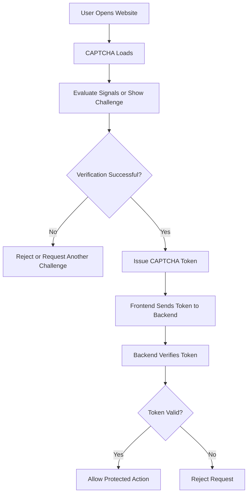
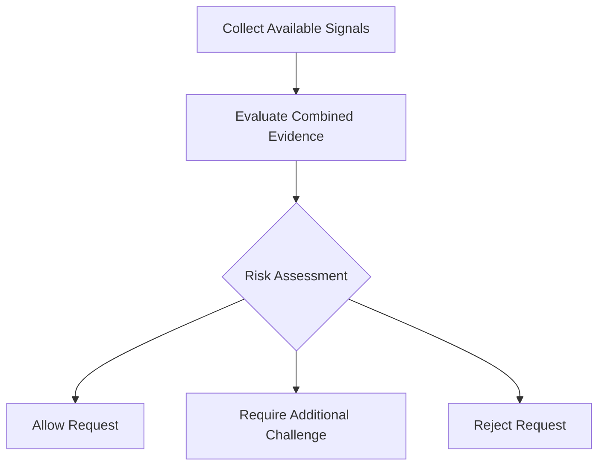
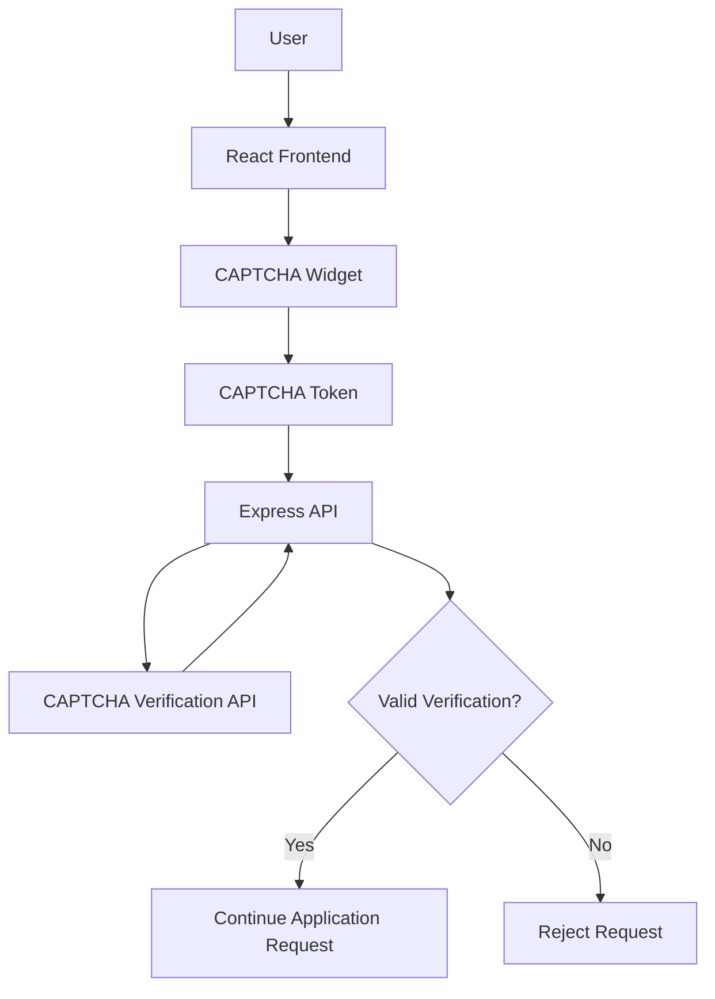

# 🤖 CAPTCHA: Bot Detection and Human Verification

<p align="center">
  
  
  
  
</p>

A practical guide to understanding and implementing **CAPTCHA (Completely Automated Public Turing test to tell Computers and Humans Apart)** in web applications.

This README explains how CAPTCHA works, what signals it may analyze, how it distinguishes suspicious automation from ordinary users, and how to integrate CAPTCHA verification into a React and Node.js application.

---

## 📑 Table of Contents

- [1. What Is CAPTCHA?](#-1-what-is-captcha)
- [2. Why Is CAPTCHA Needed?](#-2-why-is-captcha-needed)
- [3. How CAPTCHA Works](#-3-how-captcha-works)
- [4. CAPTCHA Types](#-4-captcha-types)
- [5. How CAPTCHA Detects Bots](#-5-how-captcha-detects-bots)
- [6. Human vs. Bot Patterns](#-6-human-vs-bot-patterns)
- [7. CAPTCHA Architecture](#-7-captcha-architecture)
- [8. Implementing Google reCAPTCHA](#-8-implementing-google-recaptcha)
- [9. Backend Token Verification](#-9-backend-token-verification)
- [10. Security Best Practices](#-10-security-best-practices)
- [11. Testing CAPTCHA](#-11-testing-captcha)
- [12. Limitations of CAPTCHA](#-12-limitations-of-captcha)
- [13. Further Reading](#-13-further-reading)

---

## 🛡️ 1. What Is CAPTCHA?

CAPTCHA is a security mechanism designed to help websites distinguish legitimate user interactions from automated activity.

It is commonly used to protect:

- Registration forms
- Login pages
- Contact forms
- Comment sections
- Public APIs
- Online surveys
- Account recovery workflows

### Example: CAPTCHA checkbox


*Illustrative example of a Google reCAPTCHA checkbox. The actual interface may vary.*

When a user clicks **"I'm not a robot,"** the system does not simply trust the click. Depending on the CAPTCHA product, it may evaluate browser characteristics, interaction signals, request context, and other risk indicators.

The system may allow the interaction, request an additional challenge, or reject the request.

---

## 🚨 2. Why Is CAPTCHA Needed?

Websites receive requests from both humans and automated programs.

Without appropriate protection, bots can repeatedly submit forms, create fake accounts, scrape public information, or abuse application endpoints.

### Common examples

| Threat | Example | CAPTCHA's role |
|---|---|---|
| Automated form submissions | A script repeatedly submits a contact form | Adds a verification barrier |
| Fake registrations | A bot creates large numbers of accounts | Helps identify suspicious traffic |
| Spam submissions | Automated comments flood a website | Adds friction to automated submissions |
| Web scraping | Automated clients collect public content | Can help reduce some automated access |
| Malicious automation | Scripts repeatedly invoke public actions | Can contribute to a layered defense |

**Important:** CAPTCHA is one security layer, not a complete solution for every type of abuse.

---

## 🔄 3. How CAPTCHA Works

A typical CAPTCHA integration has four main stages.

### Step 1: Load the CAPTCHA

The frontend loads the CAPTCHA provider's JavaScript or widget.

### Step 2: Evaluate the interaction

The provider may evaluate available browser signals, interaction patterns, request context, or a challenge response.

### Step 3: Generate a token

After successful verification, the provider returns a token to the frontend.

### Step 4: Verify the token on the backend

The frontend sends the token to the application's backend. The backend validates it with the CAPTCHA provider before allowing the protected action.

### Workflow diagram



This is a simplified workflow. The exact behavior depends on the provider and CAPTCHA version.

---

## 🧩 4. CAPTCHA Types

Different CAPTCHA products use different approaches to assess whether a request is legitimate.

### 4.1 Checkbox CAPTCHA


The user interacts with a checkbox labeled "I'm not a robot."

**Example:** A registration page requires the user to complete the checkbox before submitting the form.

The provider can allow the request immediately or show an additional challenge.

### 4.2 Image CAPTCHA

<details>
<summary>View an illustrative image-challenge example</summary>


*Illustrative CAPTCHA challenge image. Availability and appearance depend on the provider.*

The user may be asked to select images containing a specified object, such as traffic lights, buses, or bicycles.

**Example:** The user selects the appropriate image tiles and submits the challenge.

</details>

### 4.3 Invisible CAPTCHA

Invisible CAPTCHA can assess a request without always presenting a visible checkbox.

**Example:** A user submits a form. If additional verification is required, the provider may present a challenge.

### 4.4 Risk-based CAPTCHA

Some systems evaluate risk signals and use a risk score or other decision mechanism to determine how a request should be handled.

**Example:** A low-risk request may proceed without an image challenge, while a suspicious request may require additional verification.

### Comparison

| Type | User interaction | Typical use |
|---|---|---|
| Checkbox | Click a checkbox | Forms and registrations |
| Image challenge | Select matching images | Additional verification |
| Invisible | May require no explicit interaction | Low-friction form protection |
| Risk-based | Depends on the risk assessment | Applications requiring adaptive verification |

Product names and available features vary by provider. These categories are descriptive rather than a guarantee that every provider implements each type in the same way.

---

## 🧠 5. How CAPTCHA Detects Bots

CAPTCHA systems may analyze several categories of signals to estimate whether activity is automated.

The exact algorithms, signal weights, and decision thresholds are proprietary and differ between implementations.

### 5.1 Mouse and Interaction Patterns

Some systems can evaluate available interaction signals, such as mouse movement, clicking, scrolling, or touch interactions.

**Illustrative example:**

- A user interacts with a form as part of a normal browsing session.
- An automated program repeatedly generates highly repetitive form interactions.

Repetitive behavior may be a risk indicator, but normal human activity can also be repetitive.

### 5.2 Timing Patterns

Systems may consider the timing and frequency of interactions or requests.

**Illustrative example:**

- A user submits a form once.
- A client submits hundreds of requests within a short interval.

The second pattern may indicate automated abuse.

Fast interactions alone do not prove that a user is a bot.

### 5.3 Browser and Environment Signals

CAPTCHA providers may assess technical browser characteristics and other signals associated with the browsing environment.

**Illustrative example:** A browser environment exhibiting characteristics associated with automation may receive additional scrutiny.

Privacy settings, browser extensions, and accessibility software can affect these signals, so they should not be interpreted as definitive proof.

### 5.4 Network and Request Signals

Systems may consider factors such as request frequency, network reputation, and suspicious traffic patterns.

**Illustrative example:** Many repeated requests from a source associated with abuse may trigger additional verification.

Shared networks, corporate proxies, and VPNs can also create unusual patterns without malicious intent.

### 5.5 Challenge Responses

When a CAPTCHA displays an image challenge, the system evaluates the submitted response according to the challenge rules.

**Illustrative example:** A user must select the requested objects in a grid of images.

Passing a challenge contributes to verification but does not guarantee that all activity from that client is legitimate.

### Summary of detection signals

| Signal category | What it may indicate |
|---|---|
| Interaction | Whether activity resembles automated interaction |
| Timing | Unusual request frequency or submission patterns |
| Browser | Characteristics of the browsing environment |
| Network | Potentially suspicious traffic |
| Challenge response | Whether the challenge was completed correctly |

No single signal reliably proves that a user is human or a bot.

---

## 👤 6. Human vs. Bot Patterns

Consider two clients interacting with the same website.

### Example A: Ordinary user

A user opens a registration page, fills in the form, completes CAPTCHA, and submits it.

### Example B: Potential automated client

A script repeatedly submits requests to the same endpoint at a high rate.

| Observation | Ordinary user activity | Potentially suspicious activity |
|---|---|---|
| Request frequency | Occasional submissions | Repeated high-volume submissions |
| Form usage | Submissions related to a task | Repetitive submissions at scale |
| Browser signals | Plausible browser context | Possible automation-related characteristics |
| Network history | No known abuse signals | Source associated with suspicious traffic |
| CAPTCHA challenge | May pass | May fail or require further checks |

These examples illustrate possible patterns, not fixed rules used by any particular CAPTCHA provider.

### Conceptual risk assessment



A CAPTCHA provider may combine signals to make a risk decision. The actual process can be more complex than this conceptual diagram.

---

## 🏗️ 7. CAPTCHA Architecture

A common architecture uses React for the frontend and Node.js with Express for the backend.



### Component responsibilities

| Component | Responsibility |
|---|---|
| React | Renders the CAPTCHA widget and collects the token |
| CAPTCHA provider | Evaluates the challenge or request |
| Express | Enforces the application's verification policy |
| Verification API | Confirms whether the token is valid |
| Protected endpoint | Executes the intended operation only after required checks |

**Security rule:** Never rely exclusively on frontend validation. A client can bypass frontend controls and send requests directly to your backend.

---

## ⚙️ 8. Implementing Google reCAPTCHA

This section demonstrates a checkbox integration using React, Node.js, and Express.

### 8.1 Register the application

Open the [Google reCAPTCHA Admin Console](https://www.google.com/recaptcha/admin/create).

Register your domain and select a compatible CAPTCHA type.

The provider supplies keys for your integration.

- **Site key:** Used by the frontend.
- **Secret key:** Used exclusively by the backend.

Never expose the secret key in frontend code.

### 8.2 Install the React package

```bash
npm install react-google-recaptcha
```

### 8.3 Render the CAPTCHA widget

```jsx
import { useState } from "react";
import ReCAPTCHA from "react-google-recaptcha";

export default function CaptchaForm() {
  const [token, setToken] = useState(null);

  async function handleSubmit(event) {
    event.preventDefault();

    if (!token) {
      alert("Please complete CAPTCHA");
      return;
    }

    const response = await fetch("/api/submit", {
      method: "POST",
      headers: {
        "Content-Type": "application/json"
      },
      body: JSON.stringify({
        captchaToken: token
      })
    });

    const data = await response.json();

    if (!response.ok) {
      setToken(null);
      alert(data.message || "Verification failed");
      return;
    }

    alert(data.message);
  }

  return (
    <form onSubmit={handleSubmit}>
      <ReCAPTCHA
        sitekey={
          import.meta.env.VITE_RECAPTCHA_SITE_KEY
        }
        onChange={setToken}
        onExpired={() => setToken(null)}
      />

      <button type="submit" disabled={!token}>
        Submit
      </button>
    </form>
  );
}
```

This example demonstrates frontend token collection. The backend must still validate the token before performing the protected action.

---

## 🔐 9. Backend Token Verification

A CAPTCHA token must be verified by the backend with the provider.

The following example demonstrates Google's legacy reCAPTCHA checkbox verification endpoint. For new integrations, review the current provider documentation and choose the appropriate verification API.

### Example Express endpoint

```javascript
const express = require("express");

const app = express();

app.use(express.json());

async function verifyCaptcha(token) {
  const params = new URLSearchParams({
    secret: process.env.RECAPTCHA_SECRET_KEY,
    response: token
  });

  const response = await fetch(
    "https://www.google.com/recaptcha/api/siteverify",
    {
      method: "POST",
      headers: {
        "Content-Type": "application/x-www-form-urlencoded"
      },
      body: params
    }
  );

  if (!response.ok) {
    throw new Error("CAPTCHA provider unavailable");
  }

  const result = await response.json();

  return result.success === true;
}

app.post("/api/submit", async (req, res) => {
  try {
    const { captchaToken } = req.body;

    if (
      typeof captchaToken !== "string" ||
      !captchaToken
    ) {
      return res.status(400).json({
        success: false,
        message: "CAPTCHA verification required"
      });
    }

    const isValid = await verifyCaptcha(captchaToken);

    if (!isValid) {
      return res.status(403).json({
        success: false,
        message: "CAPTCHA verification failed"
      });
    }

    // Apply any additional authorization,
    // validation, and rate-limiting checks here.
    // Perform the protected action only afterward.

    return res.json({
      success: true,
      message: "CAPTCHA verified successfully"
    });
  } catch (error) {
    return res.status(503).json({
      success: false,
      message: "Unable to verify CAPTCHA"
    });
  }
});

app.listen(5000);
```

### Example environment variables

```dotenv
PORT=5000
RECAPTCHA_SECRET_KEY=your-server-side-secret
```

Keep the actual secret in an environment variable or secret manager. Do not commit it to source control.

### Production requirements

Before allowing a protected action:

1. Verify the token with the correct CAPTCHA provider.
2. Reject invalid, expired, or reused tokens.
3. Validate hostname and other provider-specific response fields where applicable.
4. Apply rate limits independently of CAPTCHA.
5. Fail closed if verification cannot be completed for a mandatory CAPTCHA check.
6. Ensure the protected action cannot be invoked through an unprotected alternative endpoint.

---

## 🛡️ 10. Security Best Practices

- Keep CAPTCHA secret keys on the backend.
- Verify every required CAPTCHA token on the server.
- Use HTTPS in production.
- Apply rate limiting to sensitive endpoints.
- Validate request bodies and reject malformed input.
- Avoid trusting client-side flags such as `captchaVerified: true`.
- Reject expired or previously used tokens.
- Handle CAPTCHA provider outages safely.
- Avoid exposing unnecessary browser, network, or verification details in API errors.
- Provide accessible alternatives for users who cannot complete a particular challenge.
- Follow the CAPTCHA provider's privacy and data-handling requirements.

### Example: Do not trust a frontend-only flag

**Incorrect:**

```javascript
if (req.body.captchaVerified === true) {
  // Never treat a client-provided flag as proof.
}
```

**Correct approach:**

```javascript
const isValid = await verifyCaptcha(
  req.body.captchaToken
);

if (!isValid) {
  return res.status(403).json({
    message: "CAPTCHA verification failed"
  });
}
```

The second example performs verification with the provider rather than trusting a value supplied by the client.

---

## 🧪 11. Testing CAPTCHA

Test both successful and unsuccessful verification paths.

| Test case | Input or condition | Expected result |
|---|---|---|
| TC-01 | Valid CAPTCHA token | Protected action can proceed |
| TC-02 | Missing token | Request rejected |
| TC-03 | Invalid token | Request rejected |
| TC-04 | Expired token | Request rejected |
| TC-05 | Reused token | Request rejected |
| TC-06 | CAPTCHA provider unavailable | Mandatory verification fails safely |
| TC-07 | Malformed request body | Request rejected |
| TC-08 | Excessive repeated requests | Rate limiting is applied |
| TC-09 | Invalid hostname or provider context | Request rejected when applicable |
| TC-10 | Frontend bypass attempt | Backend still enforces verification |

Use provider-supported test keys or a dedicated test environment where available. Do not rely on hardcoded success responses in production.

---

## ⚠️ 12. Limitations of CAPTCHA

CAPTCHA is not a perfect human detector.

- Sophisticated automation may sometimes pass CAPTCHA.
- Legitimate users may be challenged unnecessarily.
- Privacy tools, accessibility software, and shared networks may affect risk assessments.
- Image challenges can be difficult for some users.
- CAPTCHA alone does not prevent every form of scraping, spam, or abuse.

For stronger protection, combine CAPTCHA with rate limiting, server-side validation, access controls, abuse monitoring, and other measures appropriate to your application.

---

## 📚 13. Further Reading

- [Google reCAPTCHA documentation](https://developers.google.com/recaptcha/docs/verify) — Token verification.
- [Google Cloud reCAPTCHA documentation](https://cloud.google.com/recaptcha/docs) — Current reCAPTCHA platform and integration guidance.
- [React documentation](https://react.dev/) — Frontend development.
- [Express documentation](https://expressjs.com/) — Backend routing and middleware.
- [OWASP Automated Threats to Web Applications](https://owasp.org/www-project-automated-threats-to-web-applications/) — Understanding automated web threats.

---

<p align="center">
  <b>🤖 Detect suspicious automation. Verify requests. Protect your application.</b>
</p>

<p align="center">
  CAPTCHA is most effective as one layer of a broader security strategy.
</p>
